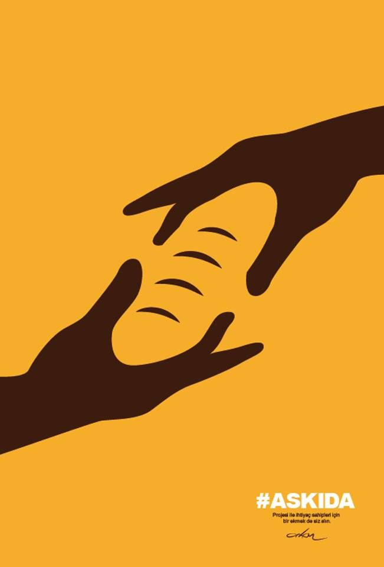

# 双手与留白中的面包

### G35

**双手与留白中的面包**

图源为用户提供的《Gestalt格式塔视觉组织.zip》中的 `Gestalt图片 (35).jpg`。

- **图中可见。** 两只深色手从对角伸来，手掌之间留出橙色空间，三条深色短弧在其间排列。
- **组织原理。** 手缘只给出部分边界，内部短弧像面包上的割纹，读者据此补齐缺失的轮廓。对角手势给出了物体所在范围。
- **设计实践。** 用局部线索暗示对象时，可将轮廓提示与物体特征放在同一区。遮住短弧作对照，检验对象是否仍可识别。
- **辅助线索。** [11-图底组织](../../01-规则库/G11-图底关系-Figure–Ground-Organization.md) · [03-良好连续原则](../../01-规则库/G03-良好连续律-Good-Continuation.md)

[返回案例库](../README.md)
