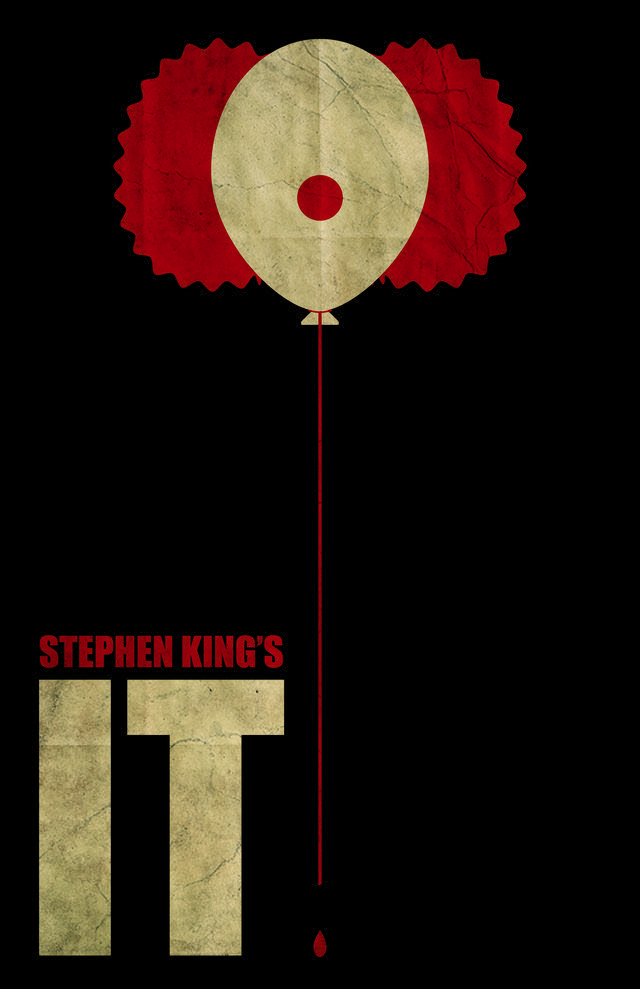

# IT 红色发形与气球

### G36

**IT 红色发形与气球**

图源为用户提供的《Gestalt格式塔视觉组织.zip》中的 `Gestalt图片 (36).jpg`。

- **图中可见。** 浅色气球居中，两侧红色团块近似镜像，正中有红点，下方细线沿轴线垂落。
- **组织原理。** 上下中轴稳定了左右组合，双侧红形和中心红点又构成小丑脸式读法。气球线保持独立物件的识别线索。
- **设计实践。** 对称构图可用一个轴上焦点把两侧连接成整体。测试剪掉一侧或移动中心点后，双重读法是否明显减弱。
- **辅助线索。** [11-图底组织](../../01-规则库/G11-图底关系-Figure–Ground-Organization.md) · [12-简洁与良好形态原则](../../01-规则库/G12-良好形态原则-Prägnanz.md)

[返回案例库](../README.md)
