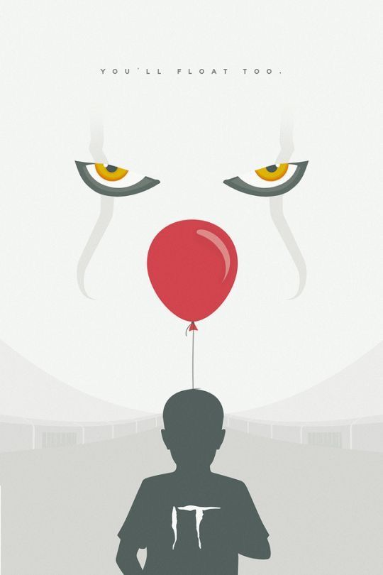

# IT 气球、系线与下方人物

### G37

**IT 气球、系线与下方人物**

图源为用户提供的《Gestalt格式塔视觉组织.zip》中的 `Gestalt图片 (37).jpg`。

- **图中可见。** 上部零散眼部细节和浅灰边缘提示一张脸；中央红气球与下方人物沿同一轴排列，细线从气球接到人物轮廓。
- **组织原理。** 细线将气球与人物组织为一组，附近的眼部和浅灰边缘可另行补全为大脸。中心气球同时参与局部连接与整体读法。
- **设计实践。** 若一个标记同时服务两层叙事，应让真实连接的端点清楚，并把作为背景的轮廓降到较低对比。按屏幕实际尺寸检查细线不断开。
- **辅助线索。** [04-闭合原则](../../01-规则库/G08-闭合律-Closure.md) · [11-图底组织](../../01-规则库/G11-图底关系-Figure–Ground-Organization.md)

[返回案例库](../README.md)
