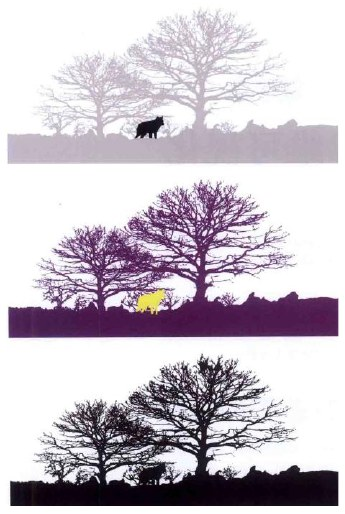
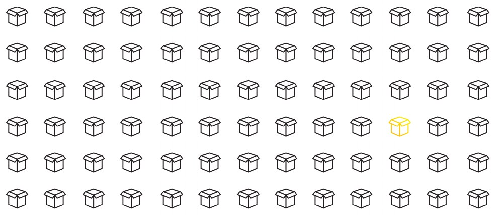

# 16 边界、对比与视觉情境

依据课件 §6.1 与 §6.5，补充三种影响视觉组织的线索。它们在分组、轮廓组织和图底分离中可以同时起作用。

## 边界与轮廓

局部边缘若能沿一致方向接续，或围成可辨认的范围，读者更容易把范围内的标记看作一个整体。课件第 45 页的点、线和三角面没有沿着外缘画出一条完整描边，但外缘片段的走向和内外密度差仍让主体轮廓可辨。

*课件图例，PDF 第 45 页。*

**设计实践。** 地图或示意图中，先让读者指出同一区域的范围，再检查哪里可能被误读为相邻区域。对照稿可分别调节边界连续程度和底图明度。 [良好连续](../01-规则库/G03-良好连续律-Good-Continuation.md) · [图底组织](../01-规则库/G11-图底关系-Figure–Ground-Organization.md)

## 对比与图底分离

相邻区域的亮暗差异、色差和边缘清晰度影响主体能否从环境中分离。课件第 30 页用相似的树与地面场景呈现不同配色。观察同一位置的小动物及其轮廓，可比较它在各图中多快能从周围区域被辨认出来。

*课件图例，PDF 第 30 页。*

**设计实践。** 若底图与重点标记粘连，可先拉开它们的明度，再逐步降低底图对比。分别在正常配色和灰度下检查主体是否清楚。

## 周围元素形成参照

周围元素重复某种形状、方向或色调时，会形成可被整体感知的环境。局部差异由此容易被看见。课件第 31 页中，等距排列的同形深色立方体组成阵列。一枚黄色立方体形状和位置仍遵循阵列规律，颜色差异则使它从阵列中凸显。

*课件图例，PDF 第 31 页。*

**设计实践。** 在重复的同类标记中突出一个对象时，保持同类项的排列和基础形状一致，再用对比色和文字标记突出目标。若标记大小已有数值含义，沿用同一尺度。让读者指出目标及其所属的组，检查强调后是否仍看得出归属。 [相似原则](../01-规则库/G02-相似律-Similarity.md)

[课件来源](../05-参考文献/README.md#用户提供的课件) · ## 案例图与设计实践

[查看本专题的案例图片、视觉组织分析与设计实践](../02-案例库/README.md#规则-16)

[返回目录](../README.md)
